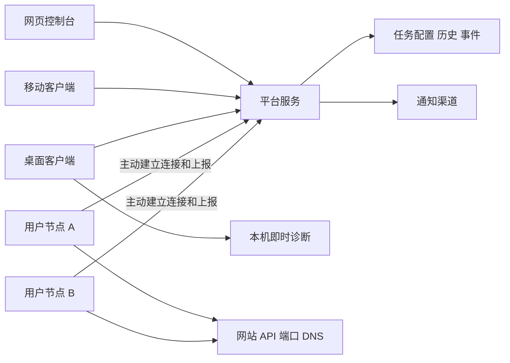

# 巡汐 Probelune 产品需求文档

> 版本：PRD v0.3｜日期：2026-10-28｜状态：首版 P0/P1 已实现并开源；独立仓库与实现决策见第 21、22 节，已验证范围与外部发行门槛见[验收记录](docs/acceptance.md)
>
> 产品名称：巡汐 Probelune（中文名：巡汐；英文名：Probelune）。
>
> 产品定位：支持自托管和用户自建探测节点的多位置服务监测与网络诊断平台。
>
> 本文保留产品需求与原始设计依据。实际代码、已验证流程及外部凭据/真机/负载边界以 [验收记录](docs/acceptance.md) 为准；性能预算不作为实测承诺。

## 目录

1. [产品结论](#1-产品结论)
2. [现有项目基础](#2-现有项目基础)
3. [竞品参考与取舍](#3-竞品参考与取舍)
4. [目标用户与核心场景](#4-目标用户与核心场景)
5. [产品组成与端侧分工](#5-产品组成与端侧分工)
6. [范围与交付阶段](#6-范围与交付阶段)
7. [页面与功能目录](#7-页面与功能目录)
8. [核心用户流程](#8-核心用户流程)
9. [站点与监测任务](#9-站点与监测任务)
10. [探测节点管理](#10-探测节点管理)
11. [状态判定与数据口径](#11-状态判定与数据口径)
12. [多位置诊断工作台](#12-多位置诊断工作台)
13. [故障事件与告警](#13-故障事件与告警)
14. [移动端需求](#14-移动端需求)
15. [桌面端演进](#15-桌面端演进)
16. [账户、权限与安全边界](#16-账户权限与安全边界)
17. [部署、数据与运维](#17-部署数据与运维)
18. [概念数据模型与接口边界](#18-概念数据模型与接口边界)
19. [体验与非功能要求](#19-体验与非功能要求)
20. [验收标准](#20-验收标准)
21. [项目目录与独立仓库](#21-项目目录与独立仓库)
22. [实施顺序与待决策项](#22-实施顺序与待决策项)
23. [参考资料](#23-参考资料)

## 1. 产品结论

### 1.1 一句话描述

用户部署一个控制台，在自己的服务器、办公室、家庭网络或不同地区部署探针，即可持续观察网站与网络服务的可用性，并从异常结果直接进入多位置诊断。

### 1.2 用户应能回答的问题

- 我的哪些站点或服务正在异常？
- 异常出现在所有观察位置，还是只出现在某个地区、运营商或内网？
- 失败发生在 DNS、连接、TLS、HTTP 还是响应内容校验阶段？
- 异常何时开始，是否持续，是否已经恢复？
- 我不在电脑旁时，能否收到通知、查看证据并发起复查？

产品只报告观测证据及有依据的判断。单个地区失败不能直接证明当地运营商故障，多个节点失败也不能单凭结果断言目标服务器宕机。

### 1.3 产品原则

1. **部署可控**：面板、数据和探针均可由用户自行部署；基础监测不依赖官方账号或官方公共节点。
2. **结果可信**：明确区分目标异常、节点离线、执行失败和数据缺失；保留证书错误、DNS 错误等原始失败原因。
3. **持续监测与即时诊断衔接**：从告警直接发起同目标、同节点的复查，减少重复输入。
4. **先把小团队体验做好**：安装简单、配置明确、告警可解释，优先覆盖个人开发者和小型运维团队。
5. **不同客户端各有重点**：网页负责配置与分析，移动端负责随身查看和处置，桌面端保留本地诊断能力。

### 1.4 首版暂不覆盖

大规模公共探针市场、托管 SaaS 计费、任意远程 Shell、服务器文件管理、完整 APM、日志平台、自动修复、复杂浏览器业务脚本和 AI 自动根因分析，均不纳入首版。

这些能力并非不可发展，但会显著增加权限、运维和产品复杂度。首版先验证“自建节点 → 监测 → 告警 → 诊断”的闭环。

## 2. 现有项目基础

现有仓库：`probelune-desktop`，基于 Electron、Vue 和 Element Plus。

| 现有能力 | 规划中的处理方式 |
| --- | --- |
| IP/域名查询、Ping、HTTP、DNS、MTR、路由追踪 | 保留产品能力，修复执行与解析问题后接入统一任务模型 |
| 批量输入、收藏夹、设置、中英文 | 作为桌面体验和网页交互的参考，按新数据模型迁移 |
| Electron IPC 与本地命令执行 | 保留为桌面本地执行适配层，不能直接作为远程任务接口 |
| 本地设置和收藏存储 | 继续支持离线使用；连接平台后的同步需要单独设计 |
| 多平台打包配置 | 继续维护，安装包兼容性另行验证 |

立项时的桌面 1.5.0 主要实现“本机检测多个目标”，缺少完整远程节点和移动体系。首版新增面板、节点、移动端与协议项目，桌面演进至 1.6.0；本节问题清单保留为改造依据，修复验证见验收记录。

已核实的质量问题包括：Shell 参数未安全处理、MTR/路由追踪缺失调用函数、默认 DNS 配置错误、HTTPS 自动降级，以及部分界面参数未生效。上述问题必须进入基础修复阶段，不能直接复制到探针服务。

## 3. 竞品参考与取舍

调研日期：2026-10-28。下表以官方仓库或官方文档为依据，属于功能与流程研究，未进行这些产品的完整部署评测。

| 产品 | 已验证的相关做法 | 巡汐 Probelune 的借鉴方式 |
| --- | --- | --- |
| [Uptime Kuma](https://github.com/louislam/uptime-kuma) | 自托管监测、多种检测类型、通知、状态页和证书信息 | 降低首次部署和创建监测的成本；首页直接展示状态与近期历史 |
| [Grafana Synthetic Monitoring](https://grafana.com/docs/grafana-cloud/observe-and-act/testing/synthetic-monitoring/set-up/set-up-private-probes/set-up/) | 注册私有探针、独立探针凭据、地域与标签配置，并为检查分配探针 | 将节点注册、身份、能力和任务分配设计为独立流程；其私有探针接入 Grafana Cloud，不等同于完全自托管方案 |
| [Globalping](https://globalping.io/) | 从分布式探针执行 Ping、DNS、HTTP、MTR 和路由追踪，可按位置和网络属性选择探针 | 即时诊断采用“目标 + 检测类型 + 观察位置”的流程，结果支持并排比较 |
| [哪吒监控](https://nezha.wiki/guide/services.html) | 指定 Probe 执行 HTTP、ICMP、TCP 服务检查，提供历史与通知 | 学习面板与 Probe 的接入方式、节点选择和线路对比；首版保持服务监测的产品重点 |
| [UptimeRobot 移动端](https://uptimerobot.com/mobile-app/) | 手机查看监测与事件、接收推送，并支持监测管理 | 移动端以告警、状态、事件详情和少量高频操作为主要入口 |

### 3.1 调研后的判断

“自建节点 + 网页面板”已有成熟参考，不能仅凭这一点宣称产品具有独有能力。Globalping 官网还列出了与 Uptime Kuma 的集成，因此也不能把多位置监测描述为市场空白。

本项目的产品假设是：**把自托管多位置监测、可解释的异常对比、已有桌面诊断工具和移动处置流程整合得足够简单，能够服务一批不需要大型运维平台的用户。** 该假设需要通过试用验证。

### 3.2 建议采用的组合

- 以站点和服务为主要管理对象，以节点为观察位置。
- 首页采用异常优先的列表和“站点 × 节点”矩阵；地图作为后续辅助视图。
- 支持持续监测，也支持一次性排障，两者共享目标与结果格式。
- 节点由用户自行部署，默认私有，不自动贡献给公共网络。
- 手机端先做好通知到事件再到复查的流程；完整配置优先放在网页端。

## 4. 目标用户与核心场景

| 用户 | 典型环境 | 核心需求 |
| --- | --- | --- |
| 独立开发者、站长 | 数个网站和不同地区的 VPS | 及时发现故障，判断是否只有某地无法访问 |
| 自托管用户 | NAS、家庭网络、内网服务 | 监测内网服务，同时了解公网访问情况 |
| 小型运维团队 | 多个业务、分支办公室、多个云平台 | 按业务管理任务，减少重复告警，保留故障证据 |
| 开发与网络排障人员 | 本地电脑和远程服务器 | 对比本地与远端的 DNS、延迟和路由结果 |

核心场景：

1. 网站在本地打开正常，但另一个地区的用户报告无法访问，运维人员选择多个节点复查。
2. 企业内网 API 只能从办公室访问，在办公室部署探针，由统一面板展示检测结果。
3. 某个探针离线，平台提示监测覆盖不足，而不是把它负责的所有站点判断为宕机。
4. 用户收到手机告警，查看失败阶段和受影响节点，发起复查并记录已确认处理。
5. 迁移域名或 CDN 后，从多个位置验证解析结果与 HTTP 响应是否符合预期。

## 5. 产品组成与端侧分工



节点主动连接平台，并通过该连接或主动拉取获取任务。上图不表示平台必须主动访问节点公网端口。

| 组成 | 职责 |
| --- | --- |
| Web | 首次初始化、站点配置、节点管理、监测矩阵、历史分析、事件、通知和权限 |
| Server | 身份验证、任务调度、结果接收、状态聚合、事件生成、通知、数据保留 |
| Probe | 接收结构化任务、执行检测、报告能力和健康状态、上报结果 |
| Desktop | 离线本地诊断；连接平台后查看监测、发起远程诊断、对比本机结果 |
| Mobile | 连接自托管实例、查看状态、接收告警、确认事件、发起复查 |

单机部署可以附带一个单独运行的本地 Probe，方便首次体验；新增其他位置的 Probe 后形成多位置观测。单台服务器即使运行多个进程，也不应被描述为具有多地区覆盖。

## 6. 范围与交付阶段

优先级：P0 为首个可用平台必需；P1 为紧接平台的多端交付；P2 为后续增强。

| 能力 | P0：平台闭环 | P1：多端闭环 | P2：增强 |
| --- | --- | --- | --- |
| 自托管 Web、Server、数据库部署 | 必须 | 持续完善 | 高可用部署 |
| Linux Probe，自建节点注册与撤销 | 必须 | 升级体验完善 | 更多运行环境 |
| HTTP/HTTPS、TCP、ICMP、DNS 持续监测 | 必须 | 更多断言 | 业务脚本、更多协议 |
| 多节点状态矩阵、历史与错误分类 | 必须 | 对比体验完善 | 地图与高级分析 |
| 即时 HTTP/DNS/Ping/TCP 复查 | 必须 | MTR、路由追踪 | 自动关联分析 |
| 故障确认、恢复、维护窗口 | 必须 | 事件备注和协作增强 | 值班与升级策略 |
| 站内事件、SMTP、通用 Webhook 通知 | 必须 | 手机推送及常用渠道 | 更多渠道 |
| 管理员与只读成员 | 必须 | 操作员角色 | 项目级细粒度授权 |
| 响应式手机网页 | 必须 | 持续完善 | — |
| 独立移动 App | — | 必须 | 小组件等 |
| 桌面端本地能力修复 | 必须 | 接入平台、结果对比 | 可选常驻节点模式 |
| 外部只读状态页 | — | 基础版本 | 自定义域名、品牌配置 |
| 官方公共节点、收费 SaaS | — | — | 独立验证后决定 |

交付关系：先完成 P0，获得真正可持续运行的后台；随后完成 P1 的移动 App 和桌面连接模式。移动端是整体产品明确组成，不要求与 P0 同时发布。

## 7. 页面与功能目录

### 7.1 网页端

```text
首次使用
├── 初始化管理员
├── 部署/连接第一个节点
├── 创建第一个监测
└── 配置并测试通知

工作台
├── 总览
│   ├── 当前异常与待处理事件
│   ├── 站点 × 节点状态矩阵
│   └── 节点健康与覆盖不足提示
├── 站点与服务
│   ├── 列表、分组、标签、搜索
│   ├── 详情：总览 / 节点对比 / 历史 / 事件 / 配置
│   └── 创建、编辑、复制、暂停、归档
├── 探测节点
│   ├── 节点列表与分组
│   ├── 添加节点与安装指引
│   └── 节点详情、能力、版本、凭据与任务
├── 即时诊断
│   ├── 目标、检测类型和位置选择
│   ├── 执行进度与并排结果
│   └── 历史诊断与导出
├── 故障事件
│   ├── 进行中 / 已恢复
│   └── 时间线、证据、确认状态与通知记录
├── 告警与维护
│   ├── 通知渠道与测试
│   ├── 规则与接收人
│   └── 维护窗口
├── 状态页（P1）
└── 设置
    ├── 成员与角色
    ├── 实例信息、时区与语言
    ├── 数据保留与备份说明
    └── 审计与访问凭据
```

### 7.2 移动端

底部导航建议为“总览、监测、事件、我的”。节点状态在总览和监测详情中进入，避免首版底部入口过多。

```text
实例连接：输入面板地址 / 扫描一次性配对码
总览：异常、节点健康、收藏站点
监测：列表、详情、节点对比、即时复查
事件：故障通知、时间线、确认、短时静默
我的：实例切换、通知诊断、设备管理、语言、退出
```

### 7.3 桌面端

保留“本地工具”入口，增加“平台监测”入口。所有结果明确标注执行位置，避免用户把远程节点结果误认为本机网络结果。

## 8. 核心用户流程

### 8.1 首次部署

1. 用户按部署文档启动平台与数据库，进入网页初始化。
2. 创建管理员，设置实例地址与显示时区；关闭开放注册。
3. 添加节点，选择部署方式，获取一次性注册凭据。
4. Probe 主动连接，面板展示节点在线、版本、可用检测能力和时间偏差。
5. 用户输入站点 URL，选择节点和通知方式，执行一次预检。
6. 预检成功后启用持续监测；进入矩阵查看第一轮结果。
7. 发送一条测试通知，明确显示渠道发送结果。

空状态应引导完成以上流程。没有节点时不能展示虚构的正常状态。

### 8.2 故障处理

持续检测出现异常 → 满足失败确认条件 → 建立事件 → 发送通知 → 用户查看失败节点与证据 → 发起一次性复查 → 确认已知悉 → 持续监测确认恢复 → 事件恢复并发送通知。

“已知悉”表示有人关注，不代表服务已恢复；一次性复查成功也不能直接覆盖持续监测状态。

### 8.3 新增位置

添加节点 → 节点上线并完成能力检查 → 为现有监测显式分配节点 → 预检 → 新节点开始产生历史数据。

P0 使用显式节点分配。新增节点不自动接管所有历史任务，避免用户无意中改变检测覆盖与告警判定。

## 9. 站点与监测任务

### 9.1 概念定义

- **站点/服务**：用户关心的业务对象，如官网、登录 API、数据库端口。
- **监测项**：对该对象的一种持续检查，如官网 HTTPS 检查、域名 DNS 检查。
- **节点**：执行检查的位置。
- **探测结果**：某个监测项在某节点某次执行的结果。
- **诊断任务**：用户手动发起的一次性检查。
- **故障事件**：一段经确认的异常及其处理记录。

创建一个简单监测时自动建立关联的服务对象，避免用户先填写多层结构；需要多个检查时再在服务详情中添加。

### 9.2 通用字段

名称、目标、协议类型、所属服务、分组/标签、执行节点、检测间隔、单次截止时间、成功条件、失败/恢复阈值、通知规则、启用状态、创建人与配置版本。

建议默认间隔 60 秒，可选 30 秒、1 分钟、5 分钟及自定义；单次默认截止时间 10 秒。一次检查的总时间预算必须小于周期，系统不堆积同一节点同一监测项的重叠执行。

### 9.3 检测类型

| 类型 | P0 配置 | 必须保存的结果 |
| --- | --- | --- |
| HTTP/HTTPS | GET/HEAD、URL、请求头、期望状态码、可选文本包含断言、重定向策略 | 最终 URL、状态码、DNS/连接/TLS/首字节/总耗时、断言、错误阶段 |
| TCP | 主机、端口、截止时间 | 连接成功与否、连接耗时、解析地址、错误原因 |
| ICMP Ping | 目标、包数、包大小、截止时间、允许丢包阈值 | 收发包数、丢包率、最小/平均/最大 RTT、IP 协议族 |
| DNS | 域名、记录类型、系统或指定解析器、可选期望值 | 实际解析器、记录集合、耗时、校验结果和错误 |
| HTTPS 证书 | 随 HTTPS 检查启用，到期提醒阈值 | 有效期、验证结果、主机名匹配情况 |

P0 HTTP 不提供任意脚本执行；POST 和带副作用的业务探测留到后续版本，以明确授权和专门配置实现。

### 9.4 检测语义

- HTTPS 失败必须如实保留，不自动替换为 HTTP。允许测试 HTTP 时应作为独立配置或独立诊断。
- 默认验证证书；若用户显式启用“允许无效证书”，结果和详情持续显示该例外，证书错误仍单独记录。
- DNS 的“系统默认”使用节点实际系统配置；每次自定义 DNS 查询使用独立解析器。
- HTTP 重定向有次数上限；每一次重定向都重新执行目标访问策略校验。
- IPv4、IPv6、自动选择为明确选项；无 IPv6 能力的节点不能将不支持误记成目标故障。
- 重试属于同一执行记录的尝试，不额外扩大成功率分母；保留首次失败和最终结果。
- 未完成的网络耗时字段显示“不可用”，不能用 0 代替。
- 大响应限制读取字节数并标记截断；不能为做状态检查无限下载响应体。

## 10. 探测节点管理

### 10.1 部署方式

P0 支持 Linux x64/arm64，提供容器和二进制服务两种部署路径。面板生成与当前实例匹配的指引，包含连接地址、凭据配置、所需网络和能力权限。

节点默认只需主动访问面板，无需开放外部入站管理端口。ICMP/MTR 等能力按运行环境声明所需权限；不要求所有节点默认以完全特权容器运行。

### 10.2 节点字段

名称、唯一 ID、用户填写的地区/网络标签、可选自动识别信息、版本、平台、支持协议、最近心跳、任务数、队列长度、时间偏差、连接状态和最近执行错误。

地域和运营商信息标注来源；用户可修正。IP 地理库结果不能证明探针真实物理位置，也不能把两个同地域标签的节点当作独立运营商证据。

### 10.3 接入与生命周期

1. 管理员创建节点记录，签发短期、一次性、仅注册用途的凭据。
2. Probe 注册后获取节点专属身份，只能读取分配给自己的任务并上报自己的结果。
3. 建议 15 秒心跳，连续 60 秒未收到心跳后判断离线；这些是可配置的初始值。
4. 节点凭据支持轮换与撤销；撤销后新请求和已有连接均应失效。
5. 删除节点前显示受影响监测；历史保留节点快照，不因删除而失去解释。
6. 节点可暂停分配新任务，允许正在运行的任务在截止时间内结束。

### 10.4 异常与兼容性

- 在线但队列持续积压：显示“繁忙”，任务无法按期执行时记录缺测。
- 缺少检测工具或权限：显示“不支持/配置异常”，不计为目标宕机。
- 节点版本低于任务所需能力：拒绝分配并给出升级提示。
- 节点重连：按任务版本恢复，过期任务不补跑成当前检测。
- 节点暂存结果建议限制为 24 小时或 100 MB，先到者为准；超限丢弃量必须上报。

## 11. 状态判定与数据口径

### 11.1 四种状态维度

| 维度 | 示例 |
| --- | --- |
| 节点连接 | 在线、离线、繁忙、已暂停 |
| 执行结果 | 成功、目标检查失败、执行器错误、超时、已取消、过期未执行 |
| 监测健康 | 正常、性能退化、部分位置异常、全部已配置位置异常、未知 |
| 管理状态 | 启用、暂停、维护中、已归档 |

管理状态独立于健康状态。例如维护期间仍可采集失败数据，只是通知被抑制。

### 11.2 单节点确认规则

建议默认连续 3 次失败确认故障，连续 2 次成功确认恢复。未达到确认阈值时显示“待确认”及最新结果，不能提前发送正式宕机通知。

无结果超过“2 个检测周期 + 单次截止时间”时标记数据陈旧。未知、缺测和执行器错误不参与连续成功/失败计数，并打断连续序列。节点失联立即提示覆盖变化，不把失联后的时段补成失败。

### 11.3 多节点聚合

- 全部已配置节点均有新鲜、已确认的正常结果：正常。
- 至少一个节点已确认失败，同时至少一个正常：部分位置异常。
- 所有已配置节点均有新鲜、已确认的失败结果：全部已配置位置异常。
- 只掌握部分节点结果：保留已知异常，同时展示“覆盖不足”；不得给出全局正常或全局故障的肯定结论。
- 所有节点无有效新鲜结果：未知。

“全部已配置位置异常”描述实际选定节点，不等于全互联网不可用。

P0 的正式通知默认在任一节点达到失败确认阈值后触发，并合并为同一监测项的事件；高级策略可指定至少 N 个节点失败。N 按配置固定，离线节点不会自动缩小 N；覆盖不足另行提示。

### 11.4 历史指标

- 单节点可用率 = 有效成功周期数 /（有效成功周期数 + 目标失败周期数）。
- 覆盖率 = 有效结果周期数 / 应执行周期数；暂停和维护排除规则必须可见。
- 执行器错误、节点离线与缺测计入覆盖损失，不作为目标失败，也不作为成功。
- 页面同时展示可用率与覆盖率；完全无有效样本时显示“暂无数据”。
- 多节点聚合按固定时间桶及配置策略计算，不直接混合各节点的原始请求次数。
- 延迟统计明确样本范围；超时展示为超时，不伪装成 0 ms。
- 采用 UTC 存储并按用户时区显示，记录执行时间与接收时间；间隔、节点配置变化保留版本。
- 迟到结果可补充历史并标注，但不回放过期实时通知，不覆盖更新的当前状态。

## 12. 多位置诊断工作台

### 12.1 使用方式

输入或从监测详情带入目标 → 选择检测类型 → 选择节点 → 提交 → 按节点逐步返回结果 → 对比或导出。

P0 支持 HTTP、DNS、Ping、TCP；P1 增加 MTR 和路由追踪。诊断失败不改变持续监测规则，也不自动产生持续故障事件。

### 12.2 展示要求

- 每个节点独立显示排队、执行、完成、失败或取消状态。
- 首个节点完成后立即展示，其他节点继续执行。
- 结果明确记录节点、目标、配置、开始时间、耗时和失败阶段。
- DNS 对比突出解析集合差异；HTTP 对比突出状态、证书、重定向和关键耗时。
- MTR/路由追踪保留无响应跳点与真实跳数，不因缺少 IP 地理信息而使整次诊断失败。
- 中间路由器不回复或丢弃探测包时，不直接生成“链路故障”的确定结论。
- 可取消排队和执行中的任务，终止对应进程；迟到上报不得把取消状态改回成功。
- 导出 JSON/CSV，默认脱敏凭据、请求头和敏感目标信息；分享链接放到后续版本。

## 13. 故障事件与告警

### 13.1 事件

事件包含首次异常时间、确认时间、受影响监测和节点、错误摘要、证据、已知悉人、维护/静默情况、恢复时间和通知记录。

同一监测项的一次连续异常合并为一个事件，节点范围变化追加时间线。状态恢复后再出现经确认异常，产生新事件。

### 13.2 通知

P0：站内事件、SMTP、通用 Webhook。P1：移动推送，并依据试用需求加入具体聊天工具渠道。

- 首次确认故障与确认恢复各通知一次；持续提醒默认关闭，允许配置。
- 节点离线生成节点事件，避免为其所有目标发出宕机通知。
- 支持按监测项分配渠道；保存后提供“发送测试通知”。
- 记录通知尝试、供应商响应、重试和最终状态。渠道已接收不等于用户已阅读。
- 通知失败独立呈现，不阻塞监测；建议重试 3 次并采用退避。
- 维护窗口抑制指定范围通知，记录仍保留；结束后根据新鲜结果重新确认。
- 确认已知悉不停止检测；静默须有明确范围和到期时间。
- Webhook 采用签名、时间戳和事件 ID，便于接收端校验与去重。

### 13.3 告警内容

通知至少包括：实例名、监测项、故障类型、受影响节点、确认时间、事件链接。默认不包含 API Key、鉴权头、完整响应体或内网拓扑。

## 14. 移动端需求

### 14.1 目标

用户在手机上完成“发现异常 → 看懂影响 → 查看证据 → 发起复查 → 确认关注”的高频流程。

### 14.2 P1 必需能力

- 输入自托管面板地址并登录，支持保存和切换多个实例。
- 扫码连接采用一次性短期配对码，码中不放管理员密码或长期令牌。
- 查看总览、监测详情、分节点状态、历史曲线和事件时间线。
- 接收故障/恢复通知，点击后定位到正确实例和事件。
- 发起即时复查，确认事件，按权限短时静默或暂停监测。
- 基础监测创建/修改可以后续补齐；复杂节点配置优先在网页完成。
- 本地缓存最后一次数据，并显著标记更新时间及离线状态。
- 手机端不作为 P1 的持续后台探针；手机休眠不影响服务器持续监测。

### 14.3 自托管推送方案

站内通知、外部通知渠道与操作系统原生推送分别设计。App 与面板保持连接不能作为可靠后台推送的替代承诺。

首版采用部署者自有 Firebase 项目：面板直接对接 FCM HTTP v1，iOS 由该项目连接 APNs，不新增独立网关仓库，也不内置官方共享凭据。推送只携带事件标识、实例地址、事件类型和通用提示，App 从自己的面板获取详情。关闭原生推送后仍可使用 SMTP/Webhook 和主动查看。

实现包括设备注册/撤销、发送记录、重试及客户端前台/后台通知入口。维护者须配置 Firebase 服务账号、平台应用参数、APNs 与签名；国内无 Google 服务或不可达 FCM 的 Android 环境不承诺该通道可用。真实设备送达验收是发行条件，不由编译通过替代。

面板仅内网可达时，App 在外网打开详情需要 VPN 或其他已配置的网络通路；收到通知不代表手机已经能访问面板。界面应解释这一状态。

## 15. 桌面端演进

- 继续支持无需平台的本地诊断，已有用户可独立使用。
- P0 优先修复命令执行、DNS、证书和结果解析问题，补充针对这些问题的回归测试。
- P1 增加平台连接、远程结果展示与本机/远端并排对比。
- 本地收藏首次导入平台时提供目标预览与重复项处理；不自动覆盖云端配置。
- 页面通过统一客户端接口调用能力，本地走 IPC，远程走平台 API。
- 检测定义、错误分类和结果结构保持一致，具体执行代码允许按平台分别实现。
- “让桌面端长期充当探针”放入 P2，需另行处理休眠、退出、升级与身份生命周期。

## 16. 账户、权限与安全边界

### 16.1 部署与角色

P0 为单实例、单团队，默认关闭公开注册，由管理员邀请成员。数据模型保留团队归属，但不同时承诺托管多租户 SaaS。

| 操作 | 管理员 | 只读成员 | 操作员（P1） |
| --- | --- | --- | --- |
| 查看监测、事件与节点状态 | 是 | 是 | 是 |
| 发起诊断、确认、静默 | 是 | 否 | 是 |
| 编辑监测与维护窗口 | 是 | 否 | 是 |
| 管理节点凭据、通知密钥、成员 | 是 | 否 | 否 |

后端对每个资源操作独立鉴权；隐藏前端按钮不能作为权限控制。

### 16.2 任务和网络边界

- Probe 只执行允许类型的结构化任务；目标、端口和数值参数统一校验，禁止任意 Shell 片段。
- 使用参数数组调用受控可执行文件，并限制参数范围、执行时长、并发和输出大小。
- 默认节点只允许公网目标；私网监测由管理员为指定节点显式配置 CIDR/域名/端口范围。
- 回环、链路本地、云元数据等敏感地址默认拒绝；必要例外必须明确配置并记录。
- DNS 解析后校验实际连接地址，重定向再次校验，避免仅检查原始字符串。
- 通知 Webhook 的目标也受出站访问策略约束。
- 浏览器页面不直接连接探针；探针不暴露通用命令服务。
- 平台和节点连接验证 TLS；自签名场景提供受控信任配置，不默认关闭证书校验。
- 对节点注册、任务修改、凭据轮换、静默和成员操作记录审计日志。

### 16.3 数据保护

节点身份与用户登录凭据分开；服务鉴权参数、通知凭据加密保存并脱敏显示。密钥随备份管理，不能只备份数据库而丢失解密能力。

默认不保存完整 HTTP 响应体。诊断原始输出设置大小与保留上限；日志、导出和通知不得输出明文令牌。

## 17. 部署、数据与运维

### 17.1 推荐部署形态

P0 提供 Docker Compose：平台服务、数据库、可选同机 Probe。Web 静态资源可随平台服务分发，用户不必单独维护前端运行服务。

平台可先采用单体服务，内部明确调度、接收、事件和通知模块；首版不要求用户搭建多个消息中间件。已确定使用 Go + Gin 与 SQLite；具体依赖版本以各仓库锁定文件为准。

### 17.2 控制台中断

- Probe 在既有任务租约有效期内继续执行已缓存任务，并暂存结果。
- 建议租约 15 分钟，持续续约；过期后停止接受旧配置继续执行，防止已撤销节点无限运行。
- 面板恢复后节点重连并同步任务，历史补传不触发过期实时告警。
- 平台自身不可用时无法承诺发出自己的故障通知，部署文档应提供独立外部监测方案。

### 17.3 数据保留建议

| 数据 | 初始建议 |
| --- | --- |
| 原始持续探测结果 | 7 天 |
| 5 分钟聚合 | 90 天 |
| 1 小时聚合 | 365 天 |
| 故障事件与审计 | 180 天 |
| 即时诊断原始输出 | 7 天，单结果限制大小 |

保留期可配置；清理前完成聚合，聚合记录保存成功、失败、缺测和分布统计所需信息。改变保留期时给出磁盘影响与删除范围提示。

### 17.4 容量估算

每天执行数 = 监测项数 × 每项节点数 × 86400 / 检测间隔秒数。

例如 100 个监测项、每项 5 个节点、60 秒间隔，约 720,000 次执行/天。每条结果若平均 1 KB，仅原始载荷约 720 MB/天，数据库索引、日志与备份另计。该估算用于设计保留策略，不是实际压测结果。

### 17.5 更新与恢复

提供固定版本镜像和发行文件、版本兼容说明、升级前备份、数据库迁移检查和恢复步骤。数据库迁移后不保证旧程序直接运行；回退应说明是否需要恢复对应备份。

备份至少包含数据库、必要密钥、实例配置；须在干净环境验证恢复，并确认节点重连和历史可读。

## 18. 概念数据模型与接口边界

### 18.1 主要实体

| 实体 | 关键字段/关系 |
| --- | --- |
| Instance / Team | 实例标识、团队、时区与策略 |
| User / Membership | 用户、角色、状态、会话 |
| Service | 名称、分组、标签、归属团队 |
| Monitor | 服务、类型、目标、配置版本、间隔、阈值 |
| Probe | 身份、标签、能力、版本、心跳、访问策略 |
| MonitorProbe | 显式分配关系、生效区间、配置版本 |
| CheckRun | 任务 ID、节点、周期、尝试、执行/接收时间、结果 |
| Diagnostic | 发起人、任务定义、节点列表、执行状态、输出 |
| Incident | 异常范围、生命周期、确认与恢复时间 |
| NotificationDelivery | 事件、渠道、去重键、尝试与结果 |
| MaintenanceWindow | 时间范围、影响资源、通知策略 |
| AuditLog | 操作者、资源、动作、时间和脱敏变更摘要 |

### 18.2 必需约束

- 任务和结果带稳定 ID，重复上报幂等处理，不重复增加样本或发告警。
- 配置修改产生新版本，旧执行保留当时的节点与规则快照。
- 用户 API、节点协议与实时事件流版本化；节点能力协商明确。
- API 支持分页、过滤、统一错误结构和合理限流。
- Web、移动端、桌面端共享服务端身份和资源语义，不各自实现不同告警判定。
- 长任务采用提交、查询/订阅、取消流程，不通过一个无限等待的请求完成。

本节定义产品所需的数据关系；具体表结构、OpenAPI 和节点协议在技术设计阶段形成独立文件。

## 19. 体验与非功能要求

### 19.1 界面要求

- 总览优先显示异常和覆盖不足，正常项可折叠或筛选。
- 矩阵单元显示状态、延迟和数据时间；点击进入证据，不只显示红绿颜色。
- “未知”“节点离线”“检查失败”使用不同文案和图标。
- 手机窄屏将矩阵转换为服务卡片与节点列表，避免强制横向滚动才能看懂状态。
- 首版支持中文和英文，默认跟随系统语言并允许切换。
- 危险操作明确显示影响对象；批量暂停/删除给出数量与范围。
- 示例图表必须标为演示数据，正式空实例保持真实空状态。

### 19.2 建议验证目标

以下为规划验收预算，需在记录硬件、网络、数据规模的环境中压测验证：

- 参考负载：100 个监测项 × 5 个节点，60 秒周期，20 个并发查看用户。
- 新鲜结果到达服务端后，页面在 3 秒内更新；不包含公网传输不可控延迟。
- 正常负载下 95% 周期任务在计划时间后 5 秒内开始。
- 故障满足确认条件后，10 秒内产生通知发送尝试；外部渠道送达时间单独记录。
- 诊断提交后 1 秒内显示已接收/排队；实际完成时间按协议预算。
- 节点和服务端重启、网络闪断、重复上报、迟到数据均不能产生重复事件或错误恢复。

首轮压测应报告未达标项和瓶颈，不把目标数字写成对外性能承诺。

### 19.3 产品验证指标

首次安装至首条有效结果的时间、节点注册成功率、首条通知配置成功率、缺测比例、误报比例、从告警到查看证据的时间、从事件页发起复查的比例。

建议先邀请少量有多服务器或内网监测需求的用户试用，观察他们是否持续使用节点对比和事件复查，再决定扩大功能范围。

## 20. 验收标准

| 编号 | 场景 | 通过条件 |
| --- | --- | --- |
| AC-01 | 首次部署 | 按文档在干净环境启动实例，创建管理员、注册节点并得到真实结果 |
| AC-02 | 多节点观测 | 同一目标分配到两个不同网络节点，独立保存与展示结果及来源 |
| AC-03 | 部分位置异常 | 一个节点达到失败阈值、另一个正常，显示部分异常和受影响节点 |
| AC-04 | 节点断连 | 停止 Probe，产生节点离线/覆盖不足提示，不制造目标宕机 |
| AC-05 | DNS 检测 | 默认解析器可正常使用；并发自定义解析器查询不互相污染 |
| AC-06 | HTTPS 错误 | 过期或不可信证书被如实记录，不以 HTTP 成功替代 |
| AC-07 | 故障与恢复 | 3 次失败确认、2 次成功恢复；重复结果不产生重复通知 |
| AC-08 | 维护与确认 | 维护抑制通知但保留数据；已知悉不等于恢复 |
| AC-09 | 即时诊断 | 按节点逐步返回结果；可取消；不覆盖持续监测状态 |
| AC-10 | 节点撤销 | 撤销身份后已有连接失效，新任务无法获取，上报被拒绝 |
| AC-11 | 权限 | 只读用户无法通过直接 API 调用创建任务、静默事件或读取密钥 |
| AC-12 | 输入和出站策略 | Shell 特殊字符不能执行额外命令；未授权内网及重定向地址被拒绝 |
| AC-13 | 迟到和补传 | 补传进入历史，不覆盖较新状态，不补发过去的故障通知 |
| AC-14 | 数据口径 | 缺测不算成功；0 有效样本显示暂无数据；可用率同时展示覆盖率 |
| AC-15 | 备份恢复 | 新环境恢复配置与历史，原节点按受控流程恢复连接 |
| AC-16 | 移动端 P1 | 连接自托管实例，查看真实事件，发起复查；推送在支持的真实设备与网络环境验证 |
| AC-17 | 桌面端 P1 | 本地诊断可独立运行；连接平台后本机与远端结果来源清晰 |
| AC-18 | 通知失败 | 渠道不可用时显示失败与重试记录，监测继续运行 |

安全相关验收使用受控本地样例与测试环境，不向无授权第三方目标执行探测或攻击验证。

## 21. 项目目录与独立仓库

**每个产品项目使用独立 Git 仓库。网页控制台和后端属于同一个平台项目，在 `probelune-dashboard` 仓库内一起开发、发布和部署。** 根目录用于总需求、跨项目文档和本地联调，不收录各子项目源码，不采用单仓库管理全部项目。

以下为实际项目结构。根目录独立发布为 `sihuangtech/probelune` 文档仓库，忽略所有子项目源码与私有联调数据。

```text
multisiteprobe/                         # 本地工作区；总文档单独管理
├── PRD.md                             # 产品总需求
├── README.md                          # 产品介绍与各独立仓库入口
├── go.work                            # 仅用于本地 Go 多模块联调
├── docs/                              # 跨项目架构、协议、部署、验收记录
├── scripts/                           # 独立仓库克隆与构建检查入口
├── probelune-dashboard/                # 独立仓库：平台
│   ├── web/                           # Vue 3 + TypeScript + Vite 控制台
│   ├── server/                        # Go + Gin 后端
│   │   ├── cmd/server/                # 程序入口
│   │   └── internal/                  # 身份、存储、任务、事件、通知等模块
│   ├── Dockerfile / compose.yaml       # 平台容器与单机部署入口
│   ├── deploy/                        # HTTPS 反向代理与 systemd 示例
│   └── docs/                          # 平台开发、API 与运维文档
├── probelune-node/                   # 独立仓库：Go 探测节点
│   ├── cmd/node/                     # 命令行入口
│   ├── internal/                      # 注册、同步、执行、结果缓冲
│   ├── pkg/checks/                    # 网络检测实现
│   └── deploy/                        # 节点镜像与 systemd 配置
├── probelune-desktop/                 # 独立仓库：现有 Electron + Vue 桌面端
├── probelune-mobile/                  # 独立仓库：Flutter Android/iOS 客户端
│   └── lib/                           # 连接、缓存、监测、事件与通知模块
└── probelune-contracts/               # 独立仓库：版本化协议定义
    ├── *.go                           # Go 共享数据结构与校验
    └── docs/                          # HTTP/JSON 协议及客户端接入约定
```

### 21.1 仓库边界

| 项目 | 仓库职责 | 发布方式 |
| --- | --- | --- |
| `probelune-dashboard` | 网页、后端、平台部署配置 | 平台版本统一发布；网页资源随服务分发 |
| `probelune-node` | 节点注册、执行、结果上报与缓存 | 独立二进制与容器 |
| `probelune-desktop` | 本地诊断、平台连接与远端对比 | 独立桌面安装包，保留已有 Git 历史 |
| `probelune-mobile` | 实例连接、状态、事件、复查与推送 | 独立 Android/iOS 客户端 |
| `probelune-contracts` | 任务、结果、错误分类与协议兼容约定 | 版本化库与协议文档，无独立运行服务 |

各仓库在 `sihuangtech` 组织独立发布。原桌面远程仓库已更名为 `sihuangtech/probelune-desktop`，保留原 Git 历史。根文档仓库不提交嵌套项目或 Git 子模块；所有 README 默认英文，并提供 `README.zh-CN.md`。

`probelune-contracts` 的作用是统一跨端协议。Go 项目复用其类型与校验；网页、桌面和移动端遵守相同 HTTP/JSON 约定。共享协议不意味着把不同语言的运行时打包到同一个项目，也不要求客户端直接依赖 Go 代码。

### 21.2 已确定的技术方案

- 网页：Vue 3、TypeScript、Vite；复用桌面端交互经验。
- 平台：Go、Gin、SQLite；单体服务内部按职责拆分，前端与后端统一部署。
- 探针：Go，Linux x64/arm64 首发，提供二进制与容器。
- 桌面：保留 Electron 与 Vue，先修复已有执行与安全问题，再接入平台。
- 移动：Flutter，Android 与 iOS 共用应用代码，平台推送能力分别配置和验证。
- 通信：版本化 HTTPS/JSON；节点主动拉取任务和上报，避免要求开放入站端口。
- 依赖：使用官方初始化和包管理命令，优先当前稳定版本；遇到兼容问题优先替换方案。
- 工程：模块化、必要中文注释，手写代码文件原则上控制在 300 行以内；生成文件与锁文件不受该限制。
- 验证：以实际构建、运行和接口联调为主，记录验证边界，不把编译通过当作真实设备或推送送达证明。

## 22. 实施顺序与待决策项

### 22.1 建议顺序

1. **基础整理**：完成依赖升级，修复已确认检测问题，定义统一错误与结果格式。
2. **最小纵向闭环**：一个平台、一个 Probe、一个 HTTPS 监测，完成注册、调度、上报和页面展示。
3. **多位置与可信状态**：增加多个节点，打通部分异常、覆盖不足、历史和数据去重。
4. **告警与可部署版本**：故障/恢复、SMTP/Webhook、维护窗口、备份和安装验收。
5. **多端接入**：发布移动端，接入桌面平台模式，完成通知到复查流程。
6. **按真实需求增强**：MTR/路由对比、状态页、更多渠道、地图和协作权限。

不按未经估算的固定天数承诺进度。每个阶段以可演示、可重复验证的完整用户流程作为完成标准。

### 22.2 已采用的规划假设

- 产品名称已确定为「巡汐 Probelune」，中文名为「巡汐」，英文名为「Probelune」。

- 自托管优先，用户自建私有节点是主流程。
- Web 是配置中心，移动端是随身监测和处置入口。
- P0 使用单团队实例和显式节点分配。
- Linux 为长期探针首发平台，桌面端继续保留独立本地工具模式。
- 先采用清晰、确定的规则和证据展示，不依赖 AI 才能判断状态。

### 22.3 首版实现决策与发行边界

| 事项 | 已采用的决策 |
| --- | --- |
| 首批用户 | 个人开发者、自托管用户、小型团队；不承诺大规模压测结论 |
| 移动平台 | 同一 Flutter 工程生成 Android/iOS；签名与真机推送单独验收 |
| 原生推送 | 部署者自有 Firebase/APNs，面板直接发送；SMTP/Webhook 保留 |
| 开源边界 | 完整自托管源码使用 GPL-3.0-or-later；不实现收费托管服务 |
| 服务对象 | 首版由监测名称、分组和标签承载，避免空的多层 Service CRUD |
| 移动导航 | 监测（含总览）、事件、节点、设置；复杂配置留在网页 |
| 预检 | 即时诊断用于预检；创建时可先禁用，确认后启用，不强制先发送真实请求 |
| 提醒 | 渠道可设持续提醒间隔，默认 0；静默与维护优先，恢复后停止 |
| 证书 | 可配置最低剩余有效天数断言；失败保留 HTTP 与证书证据，不宣称服务端必然宕机 |
| 性能退化 | 首版展示延迟、失败与覆盖证据；独立性能评分/阈值告警列入后续增强 |
| 存储与时间 | 原始 7 天、5 分钟 90 天、小时 365 天；UTC 存储，网页实例时区，原生客户端设备时区 |
| 验证 | 本机双节点、容器、Electron、Android 模拟器及无签名 iOS 构建；真实跨地区网络、签名和推送不冒充已验收 |

## 23. 参考资料

以下为本次使用的第一方来源，查询日期均为 2026-10-28。文中的具体产品设计和优先级为结合现有代码提出的建议，不表示这些参考产品采用相同实现。

1. [Uptime Kuma 官方仓库：功能、通知、状态页与部署](https://github.com/louislam/uptime-kuma)
2. [Grafana：设置私有探针](https://grafana.com/docs/grafana-cloud/observe-and-act/testing/synthetic-monitoring/set-up/set-up-private-probes/set-up/)
3. [Grafana：配置私有探针能力](https://grafana.com/docs/grafana-cloud/observe-and-act/testing/synthetic-monitoring/set-up/set-up-private-probes/configure/)
4. [Globalping：多位置网络测试与集成](https://globalping.io/)
5. [Globalping Probe 官方仓库](https://github.com/jsdelivr/globalping-probe)
6. [哪吒监控：服务监控配置与结果](https://nezha.wiki/guide/services.html)
7. [哪吒监控：架构与数据流](https://nezha.wiki/guide/architecture.html)
8. [UptimeRobot：移动客户端](https://uptimerobot.com/mobile-app/)
9. [UptimeRobot：移动推送配置](https://help.uptimerobot.com/en/articles/17662644-uptimerobot-mobile-app-push-notifications)
