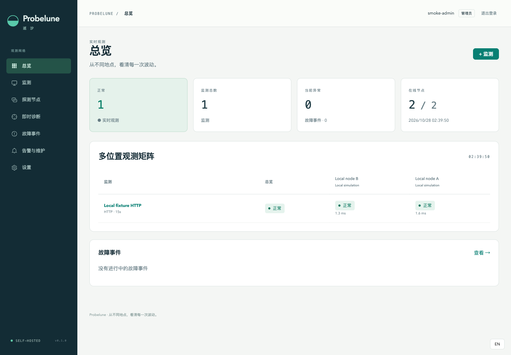

# Probelune · 巡汐

[简体中文](README.zh-CN.md) · [Product requirements](PRD.md) · [Acceptance record](docs/acceptance.md)

**Self-hosted service monitoring from your own locations.** Deploy probe nodes on your servers or private networks, see availability and coverage together, then investigate with web, desktop and mobile clients.



## Explore Probelune

Probelune brings your service health to the web, phone and desktop, with probes on the networks you want to observe.

To set up Probelune, start with the dashboard and a probe node, then connect the clients you use. The project overview has the architecture and deployment guides.

| Component | What it provides |
| --- | --- |
| [Project overview](https://github.com/sihuangtech/probelune) | Product overview, architecture and deployment guides |
| [Dashboard](https://github.com/sihuangtech/probelune-dashboard) | Web dashboard and Go API server |
| [Probe node](https://github.com/sihuangtech/probelune-node) | Probe executor for monitored networks |
| [Mobile app](https://github.com/sihuangtech/probelune-mobile) | Flutter client for Android and iOS |
| [Desktop app](https://github.com/sihuangtech/probelune-desktop) | Electron desktop client and diagnostic tools |
| [Contracts](https://github.com/sihuangtech/probelune-contracts) | Shared Go models, validation and API protocols |


## Start using Probelune

1. Start the dashboard [from source](https://github.com/sihuangtech/probelune-dashboard#source-deployment) or with [Docker Compose](https://github.com/sihuangtech/probelune-dashboard#quick-start-docker-compose).
2. Create and deploy [nodes](https://github.com/sihuangtech/probelune-node) on the networks you want to observe.
3. Add HTTP/HTTPS, TCP, UDP, ICMP or DNS monitors; choose nodes and notification channels.
4. Connect the desktop/mobile apps to that same dashboard. Complex configuration stays in the web console.

Node disconnection is a coverage problem, not proof a target is down. Repeated results are idempotent; old samples remain history. Incidents require configured consecutive failures/recoveries. HTTPS verification is enabled by default; private checks require an explicit node CIDR policy. Native push is optional and uses your Firebase/APNs project.

## Develop across projects

```sh
git clone https://github.com/sihuangtech/probelune.git
cd probelune
./scripts/clone-projects.sh
```

Read each project's README before installing its toolchain. The helper skips existing directories and never overwrites local work. An optional local `go.work` is ignored; release builds must use published contract versions with `GOWORK=off`.

[Architecture](docs/ARCHITECTURE.md) · [Implementation decisions](docs/DECISIONS.md) · [Acceptance](docs/acceptance.md) · [Release checklist](docs/RELEASE.md) · [Verified initial release](docs/RELEASE-2026-10-28.md)

Initial validation includes real local/contained checks, browser/Electron UI, Android emulator connection, native builds and backup restoration. It does not establish real geographic coverage, production-scale SLOs, signed distribution or FCM/APNs device delivery. Screenshots show clearly labelled local fixtures.

GPL-3.0-or-later. See [LICENSE](LICENSE), [CONTRIBUTING.md](CONTRIBUTING.md), [SECURITY.md](SECURITY.md) and [Releases](https://github.com/sihuangtech/probelune/releases).

## Star History

[](https://star-history.com/#sihuangtech/probelune&Date)

## Contact

- Developer: [Snake Konginchrist](https://github.com/Snake-Konginchrist)
- Email: [developer@skstudio.cn](mailto:developer@skstudio.cn)
- Feedback: [GitHub Issues](https://github.com/sihuangtech/probelune/issues)

Deployment: [web console and probe node guide](docs/DEPLOYMENT.md).
