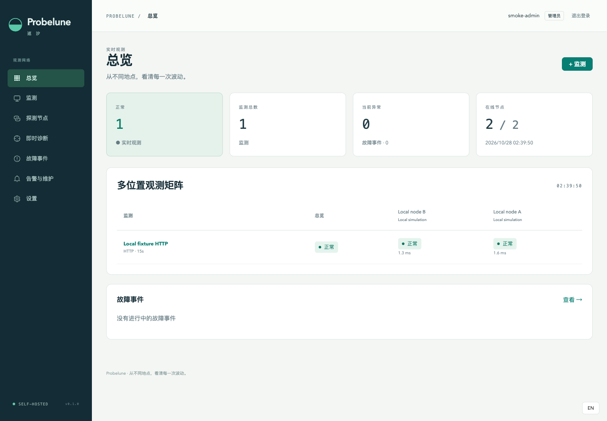

# 巡汐 Probelune

[English](README.md) · [PRD](PRD.md) · [验收记录](docs/acceptance.md)

在自己的服务器、办公室和私有网络部署探测节点，用网页、桌面和手机观察服务状态，并从故障直接发起多位置诊断。



## 独立项目

| 仓库 | 职责 | 首版 |
| --- | --- | --- |
| [probelune-dashboard](https://github.com/sihuangtech/probelune-dashboard) | Vue 网页 + Go 后端，一起部署 | 0.1.0 |
| [probelune-node](https://github.com/sihuangtech/probelune-node) | Go 探测节点，Linux 二进制/容器 | 0.1.0 |
| [probelune-desktop](https://github.com/sihuangtech/probelune-desktop) | Electron 本地工具与远端对照，保留旧历史 | 1.6.0 |
| [probelune-mobile](https://github.com/sihuangtech/probelune-mobile) | Flutter Android/iOS 客户端 | 0.1.0 |
| [probelune-contracts](https://github.com/sihuangtech/probelune-contracts) | Go 数据定义、校验和接口协议 | 0.1.1 |

本仓库只管理总文档与本地辅助脚本，不收录五个子项目源码、不创建 Git 子模块。各项目独立构建与发布；面板的网页和后端属于同一个仓库。

## 使用流程

面板支持 [源码部署](https://github.com/sihuangtech/probelune-dashboard#source-deployment) 和 [Docker Compose](https://github.com/sihuangtech/probelune-dashboard#quick-start-docker-compose)。启动后添加并部署 [探测节点](https://github.com/sihuangtech/probelune-node)，配置 HTTP/HTTPS、TCP、ICMP、DNS 监测和通知，再连接桌面或移动客户端。复杂配置在网页完成，手机用于查看和处置，桌面保留离线本地工具。

节点离线代表覆盖不足，不等于目标宕机；失败与恢复按连续阈值确认。重复结果幂等，迟到结果只进入历史。HTTPS 默认验证证书，私网监测需要显式 CIDR 许可。原生推送可选，使用部署者自己的 Firebase/APNs。

```sh
git clone https://github.com/sihuangtech/probelune.git
cd probelune
./scripts/clone-projects.sh
```

脚本跳过已有目录，不覆盖本地工作。各项目依赖安装与构建见各自 README；本地可选 `go.work` 不提交，发布通过 `GOWORK=off` 读取正式协议版本。

[架构](docs/ARCHITECTURE.md) · [实现决策](docs/DECISIONS.md) · [验收](docs/acceptance.md) · [发布检查](docs/RELEASE.md) · [首版提交与 CI 证据](docs/RELEASE-2026-10-28.md)

已验证本地/容器网络检查、浏览器与 Electron、Android 模拟器连接、原生构建及备份恢复；不将它们冒充真实跨地区覆盖、生产容量承诺、签名上架或 FCM/APNs 真机送达。截图来自明确标注的本地样例。

采用 [GPL-3.0-or-later](LICENSE)，另见 [贡献](CONTRIBUTING.md)、[安全](SECURITY.md)、[更新记录](CHANGELOG.md)。


## 星标历史

[](https://star-history.com/#sihuangtech/probelune&Date)

## 联系开发者

- 开发者: [Snake Konginchrist](https://github.com/Snake-Konginchrist)
- 邮箱: [developer@skstudio.cn](mailto:developer@skstudio.cn)
- 问题反馈: [GitHub Issues](https://github.com/sihuangtech/probelune/issues)
