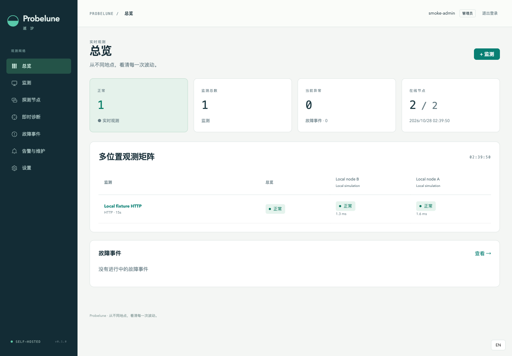

# 巡汐 Probelune

[English](README.md) · [PRD](PRD.md) · [验收记录](docs/acceptance.md)

在自己的服务器、办公室和私有网络部署探测节点，用网页、桌面和手机观察服务状态，并从故障直接发起多位置诊断。



## 了解 Probelune

Probelune 让你通过网页、手机和桌面查看自己的服务状态，并从不同网络位置排查故障。

开始自部署时，先配置网页面板和探测节点，再按需要连接手机或桌面客户端。完整架构与部署指南可以在项目总览中找到。

| 组件 | 用途 |
| --- | --- |
| [项目总览](https://github.com/sihuangtech/probelune) | 项目总览、架构与部署指南 |
| [网页面板](https://github.com/sihuangtech/probelune-dashboard) | 网页控制台与 Go API 服务端 |
| [探测节点](https://github.com/sihuangtech/probelune-node) | 部署在监测网络中的探测执行器 |
| [移动客户端](https://github.com/sihuangtech/probelune-mobile) | Flutter Android 与 iOS 移动客户端 |
| [桌面客户端](https://github.com/sihuangtech/probelune-desktop) | Electron 桌面客户端与诊断工具 |
| [协议与数据定义](https://github.com/sihuangtech/probelune-contracts) | 共享 Go 数据结构、参数校验与接口协议 |


## 使用流程

面板支持 [源码部署](https://github.com/sihuangtech/probelune-dashboard#source-deployment) 和 [Docker Compose](https://github.com/sihuangtech/probelune-dashboard#quick-start-docker-compose)。启动后添加并部署 [探测节点](https://github.com/sihuangtech/probelune-node)，配置 HTTP/HTTPS、TCP、UDP、ICMP、DNS 监测和通知，再连接桌面或移动客户端。复杂配置在网页完成，手机用于查看和处置，桌面保留离线本地工具。

节点离线代表覆盖不足，不等于目标宕机；失败与恢复按连续阈值确认。重复结果幂等，迟到结果只进入历史。HTTPS 默认验证证书，私网监测需要显式 CIDR 许可。原生推送可选，使用部署者自己的 Firebase/APNs。

```sh
git clone https://github.com/sihuangtech/probelune.git
cd probelune
./scripts/clone-projects.sh
```

脚本跳过已有目录，不覆盖本地工作。各项目依赖安装与构建见各自 README；本地可选 `go.work` 不提交，发布通过 `GOWORK=off` 读取正式协议版本。

[架构](docs/ARCHITECTURE.md) · [实现决策](docs/DECISIONS.md) · [验收](docs/acceptance.md) · [发布检查](docs/RELEASE.md) · [首版提交与 CI 证据](docs/RELEASE-2026-10-28.md)

已验证本地/容器网络检查、浏览器与 Electron、Android 模拟器连接、原生构建及备份恢复；不将它们冒充真实跨地区覆盖、生产容量承诺、签名上架或 FCM/APNs 真机送达。截图来自明确标注的本地样例。

采用 [GPL-3.0-or-later](LICENSE)，另见 [贡献](CONTRIBUTING.md)、[安全](SECURITY.md)、[发布记录](https://github.com/sihuangtech/probelune/releases)。

## 星标历史

[](https://star-history.com/#sihuangtech/probelune&Date)

## 联系开发者

- 开发者: [Snake Konginchrist](https://github.com/Snake-Konginchrist)
- 邮箱: [developer@skstudio.cn](mailto:developer@skstudio.cn)
- 问题反馈: [GitHub Issues](https://github.com/sihuangtech/probelune/issues)
