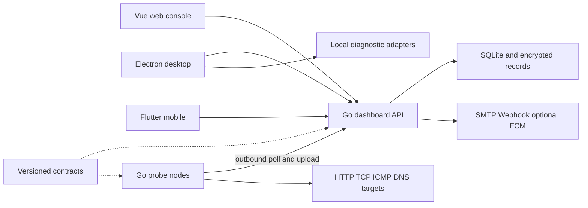

# Architecture / 总体架构

The dashboard is one deployable product containing its Vue frontend and Go backend. Probe nodes are long-running services without inbound control ports. Desktop tools can operate without a dashboard; mobile is a companion, not a probe. Contracts are a published Go module and language-neutral protocol documentation, not another server.

## Ownership and boundaries

The server owns authentication, roles, monitor versions, node assignments, historical aggregation and incident state. Clients render those states and submit allowed actions. Nodes execute only structured, validated check definitions, apply local access policies and upload observations. Each node has a separate revocable identity. User sessions never authorize node endpoints.

结果以监测、节点、配置版本和计划时间生成稳定 ID。正常周期与一次性诊断分开；补传、重复、暂停、失联和执行器错误不会冒充恢复。可用率与覆盖率分开计算，缺测不记成功。维护继续收集数据但抑制通知，结束后重新确认。

SQLite stores raw samples and time buckets, with sensitive configuration encrypted under a private local key. Backup includes a consistent database snapshot and that key. Credentials stored on desktop/mobile use operating-system facilities; provider service-account files remain server-side and outside Git.

## Repository boundaries

`probelune-dashboard`, `probelune-node`, `probelune-desktop`, `probelune-mobile` and `probelune-contracts` each have their own Git history, CI, license, changelog and bilingual README. The root `probelune` repository is documentation only. Root ignore rules exclude child projects and local runtime fixtures; no submodules are used.

Go consumers reference `probelune-contracts v0.1.1` without local replacements. Vue/Flutter/Electron consume the JSON API independently. Additive fields remain in protocol v1; breaking protocol changes require a migration and version change. Application release versions are independent of the contract library version.

Detailed implementation lives in each repository: [dashboard](https://github.com/sihuangtech/probelune-dashboard/blob/main/docs/ARCHITECTURE.md), [node](https://github.com/sihuangtech/probelune-node), [desktop](https://github.com/sihuangtech/probelune-desktop/blob/master/docs/PROBELUNE.md), [mobile](https://github.com/sihuangtech/probelune-mobile), [contracts](https://github.com/sihuangtech/probelune-contracts/tree/main/docs).
